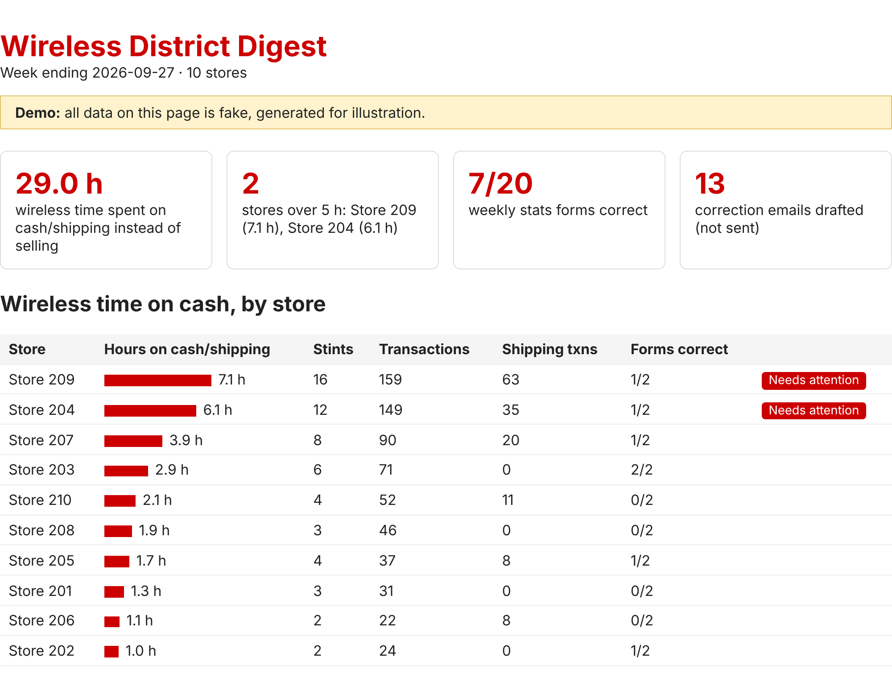

# Wireless District Digest


**[See a live example report](https://singhg349-wq.github.io/retail-wireless-digest/example_output/digest.html)** (generated from the demo data)

A Python tool that turns a week of retail store exports into a one-page report for a District Manager running about 10 stores. It answers two questions every week:

1. **How much time are wireless sales associates losing to cash and shipping?** Commission-based wireless staff often get pulled onto front-end registers. The tool finds those stints in the POS data and adds up the hours by store and by associate.
2. **Are the weekly self-reported sales forms right?** Each associate submits a weekly stats form (activations, accessory attach, device protection). The tool checks every form against the POS and carrier activation records, flags wrong IDs, store totals entered as personal numbers, swapped fields, and missing forms, and drafts a correction email for each person. Emails are drafted only, never sent.



It uses only the standard library: no installs, no API keys, nothing leaves the machine.

## Quick start

```bash
python wireless_digest.py
```

This reads the demo week in `data/` and writes `output/digest.html` plus draft emails in `output/emails/`. You can see a finished run in [`example_output/`](example_output/).

To run it on your own exports:

```bash
python wireless_digest.py --data my_data --out my_output
```

## Input files

| File | What it is | Columns the tool reads |
|---|---|---|
| `roster.csv` | Who works where, and their role | `employee_id, name, store, role, email` |
| `till_transactions.csv` | Line-level POS rows | `txn_id, store, register, cashier_id, sales_associate_id, timestamp, category, qty` |
| `carrier_activations.csv` | Activations exported from the carrier's portal | `employee_id` |
| `weekly_stats.csv` | Weekly self-reported forms | `week_ending, store, employee_id, name, activations, attach, device_protection` |

Extra columns are ignored. If a required file or column is missing, the run stops with a message naming it. Excel "CSV UTF-8" exports (with a BOM) work as they are.

## How it works

- **Cash time:** a wireless associate counts as "on cash" when their ID rings a transaction on a register whose name starts with `FE` or `SHIP`. Transactions less than 10 minutes apart are grouped into one stint, and each stint is timed from its first to its last transaction plus 3 minutes. Stores over 5 hours in a week get flagged.
- **Form audit:** the actual weekly numbers are rebuilt from the source data (activations from the carrier export, attach and device protection from POS lines credited through `sales_associate_id`) and compared field by field with each form.

These rules are constants at the top of `wireless_digest.py`, so they can be changed to match how a given store's reports work.

## Testing

All data in this repo is synthetic. `generate_fake_data.py` builds a realistic week (10 stores, 80 staff, about 4,000 POS rows) and **deliberately plants mistakes** in the forms, recording them in `answer_key.json`. `check_digest.py` then runs the digest and fails if any planted mistake is missed, anything correct is flagged, or the cash-time totals are off.

```bash
python generate_fake_data.py && python check_digest.py
python check_digest.py --data samples/busy_week
```

Two sample weeks are included:

| Folder | Week starting | Profile | Planted mistakes |
|---|---|---|---|
| `data/` | 2026-09-21 | normal | 13 |
| `samples/busy_week/` | 2026-09-28 | heavy cash pressure (`--busy`, seed 7) | 8 |

Both pass with 0 missed and 0 false alarms. GitHub Actions runs both checks on Python 3.10 and 3.12 on every push. To make a new week: `python generate_fake_data.py --out samples/new_week --week-start 2026-10-05 --seed 3`.

## Project files

```
wireless_digest.py       the digest (HTML report + draft emails)
generate_fake_data.py    synthetic data generator with planted errors
check_digest.py          test against an answer key
data/                    demo week (default input)
samples/busy_week/       second, busier week
example_output/          a finished run on data/
```

## Background

I built this while working as a wireless sales associate, after noticing how much selling time was going to cash and how often the weekly forms were wrong. I pitched it to my District Manager with a proposal for a 4-week pilot. Store names, people, IDs and sales in this repo are all invented.

## License

MIT
